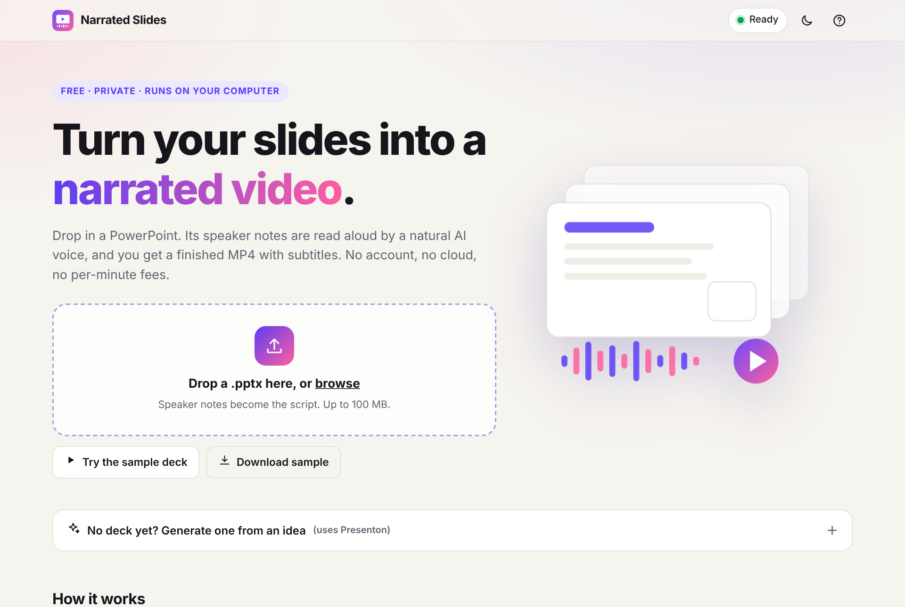
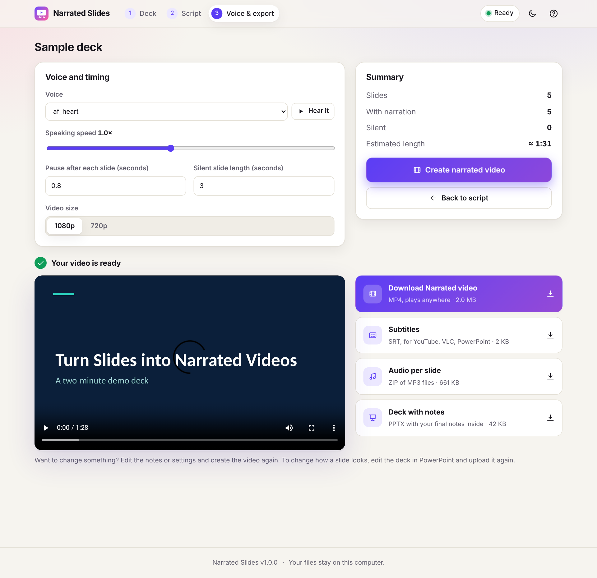
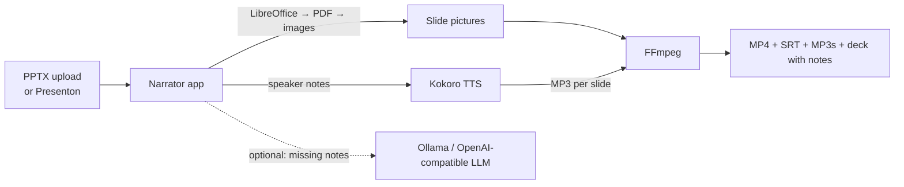

# Narrated Slides

**Turn a PowerPoint deck into a narrated MP4 video.** Your speaker notes are read aloud by a natural-sounding AI voice,
and you get the video, subtitles, per-slide audio and an updated deck. Everything runs on your own computer with Docker.
No account, no cloud, no per-minute fees.

<p align="center">
  
</p>

## Features

- **Upload a `.pptx`** or generate one from a prompt with [Presenton](https://github.com/presenton/presenton).
- **Slide-by-slide script editor.** Large preview, filmstrip, autosave, word count and spoken-length estimate.
- **Hear it before you commit.** Preview the voice for any slide.
- **Optional AI note writer** for slides that have no notes (local [Ollama](https://ollama.com) or any OpenAI-compatible API).
- **Free voices** from [Kokoro](https://github.com/remsky/Kokoro-FastAPI), or any OpenAI-compatible text-to-speech server.
- **Four downloads:** MP4 video, SRT subtitles, a ZIP of MP3s (one per slide), and your deck with the final notes written in.
- **Private by design.** Services listen on `127.0.0.1` only; files stay in a Docker volume and are deleted after 7 days.
- Light and dark theme, keyboard shortcuts, and a one-click sample deck to try it.

<p align="center">
  
  
</p>

## Quick start

You need [Docker Desktop](https://www.docker.com/products/docker-desktop/) (or Docker Engine with the Compose plugin).

```bash
git clone https://github.com/<your-user>/narrated-slides.git
cd narrated-slides
cp .env.example .env
docker compose up -d --build
```

Open **http://localhost:8000** and press **Try the sample deck**.

The first start downloads a few GB of images, and the voice service takes a minute to warm up. The status pill at the
top right turns green ("Ready") when the voice is available.

> **Port 8000 already used?** Add `NARRATOR_PORT=8010` to `.env`, run `docker compose up -d`, and open http://localhost:8010.

Want the AI note writer and local slide generation too? Start the optional Ollama container and download a small model:

```bash
docker compose --profile ollama up -d --build
docker compose exec ollama ollama pull llama3.2:3b
```

## How it works



1. **Add a deck.** Hidden slides are skipped. Each visible slide's speaker notes become its script.
2. **Edit the script.** Changes save automatically. Slides without notes stay silent for a few seconds.
3. **Export.** Pick a voice and speed. Each slide is spoken, paired with its picture, then joined into one video.

More detail: [User guide](docs/USER_GUIDE.md) · [Configuration](docs/CONFIGURATION.md) · [Troubleshooting](docs/TROUBLESHOOTING.md) · [Architecture](docs/ARCHITECTURE.md)

## Documentation

| | |
|---|---|
| [docs/USER_GUIDE.md](docs/USER_GUIDE.md) | Step by step for people using the app, including how to change a slide's look |
| [docs/CONFIGURATION.md](docs/CONFIGURATION.md) | Every setting, GPU, other voice engines, using OpenAI instead of Ollama |
| [docs/TROUBLESHOOTING.md](docs/TROUBLESHOOTING.md) | Red status lights, port conflicts, slow first start, odd-looking slides |
| [docs/ARCHITECTURE.md](docs/ARCHITECTURE.md) | For contributors: components, API, data layout |
| [CONTRIBUTING.md](CONTRIBUTING.md) | Run it without Docker, tests, ideas |

## Good to know

- **Languages.** The voice follows Kokoro's supported languages and voices (see its voice list). Check that a voice exists for your language before you plan a deck.
- **Slide look.** Slides are rendered with LibreOffice, so unusual fonts or effects may look slightly different from
  PowerPoint. Slide text is not changed by the narration, so you can fix the design in PowerPoint and upload again.
- **Speed.** Speech is generated on your CPU, so export takes a while. Try the sample deck to see how long it takes on your machine.
- **Security.** There is no login: it is meant for one person on their own machine. Do not expose the ports to the internet.

## Project layout

```
narrator/          the web app (FastAPI + plain HTML/CSS/JS) and its tests
docker-compose.yml narrator + Kokoro + Presenton (+ optional Ollama)
docs/              guides and screenshots
scripts/           screenshot generator
```

## Credits

Built on the shoulders of [Kokoro-82M](https://huggingface.co/hexgrad/Kokoro-82M) and
[Kokoro-FastAPI](https://github.com/remsky/Kokoro-FastAPI), [Presenton](https://github.com/presenton/presenton),
[Ollama](https://ollama.com), [FFmpeg](https://ffmpeg.org), [LibreOffice](https://www.libreoffice.org) and
[python-pptx](https://github.com/scanny/python-pptx). Their licenses apply to their own software.

## License

[MIT](LICENSE)
